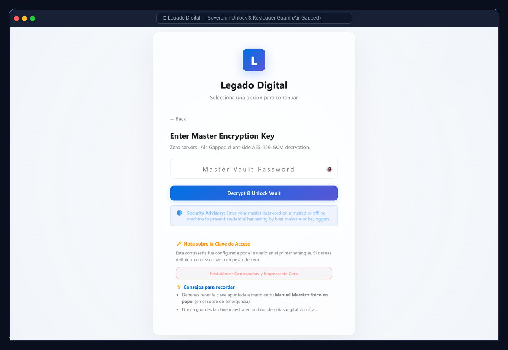
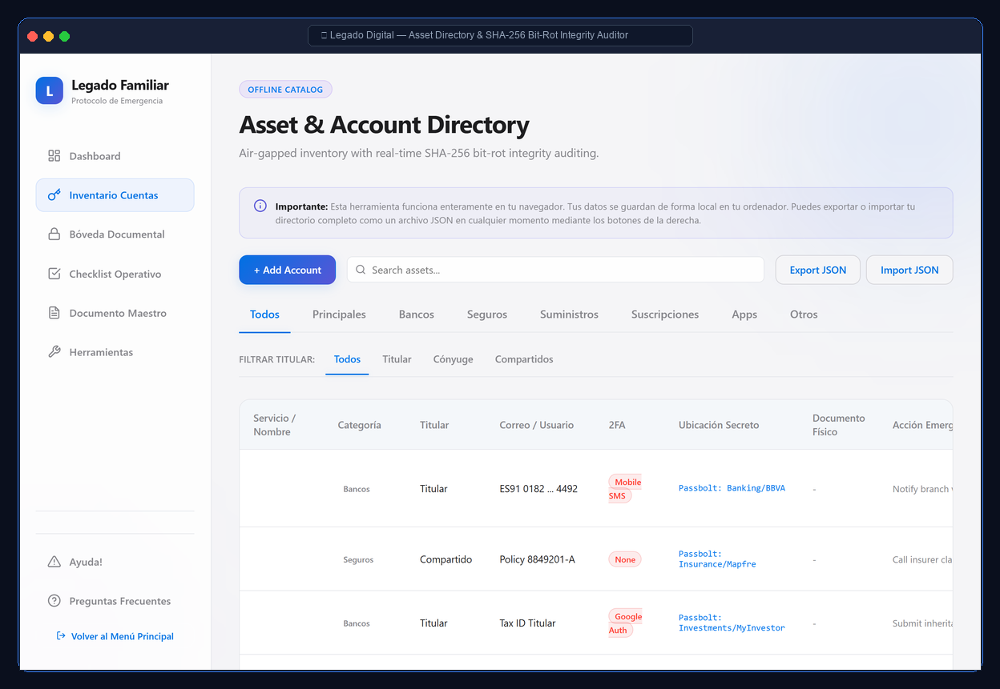
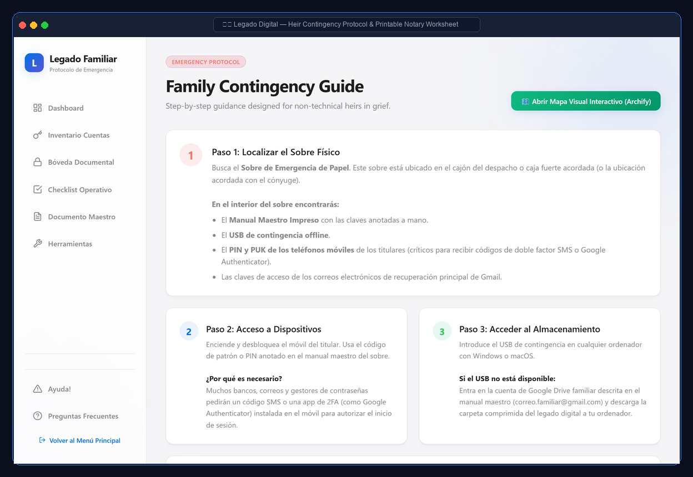
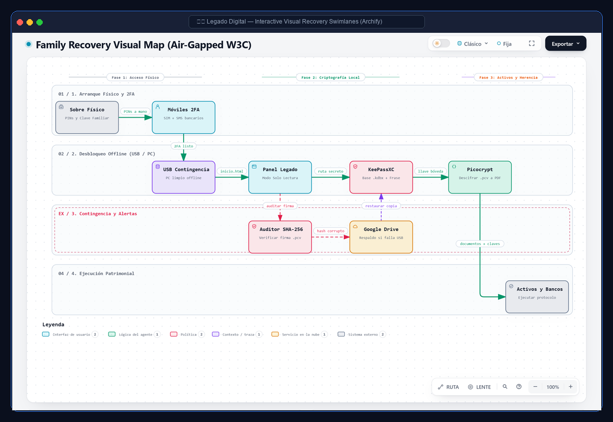
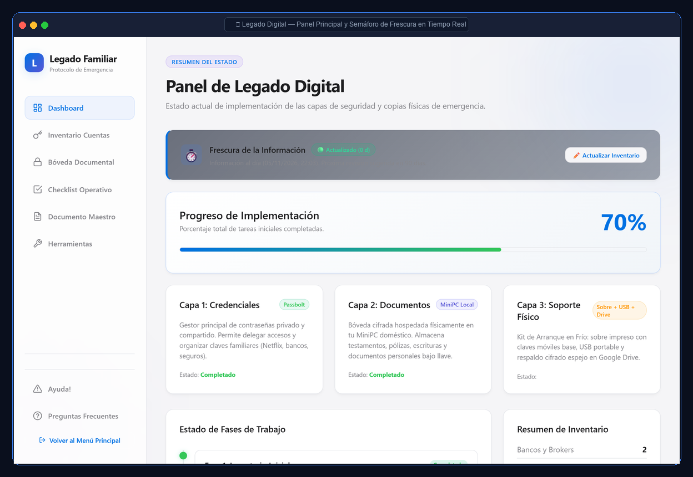
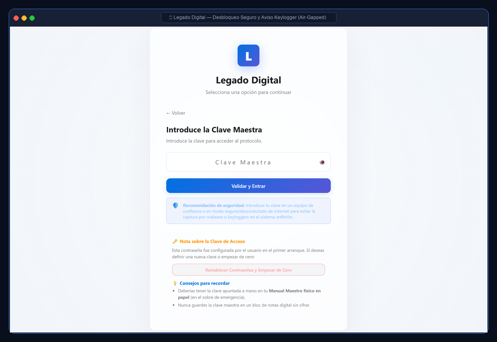
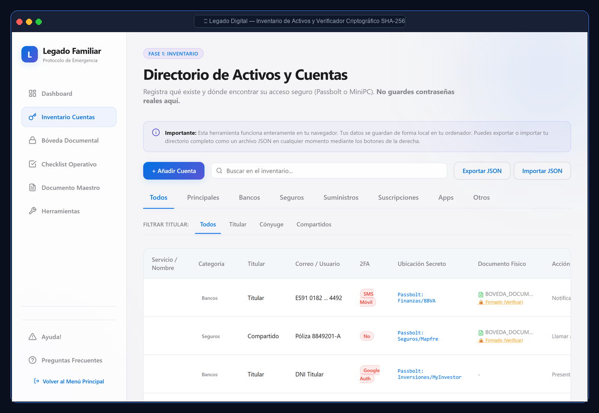
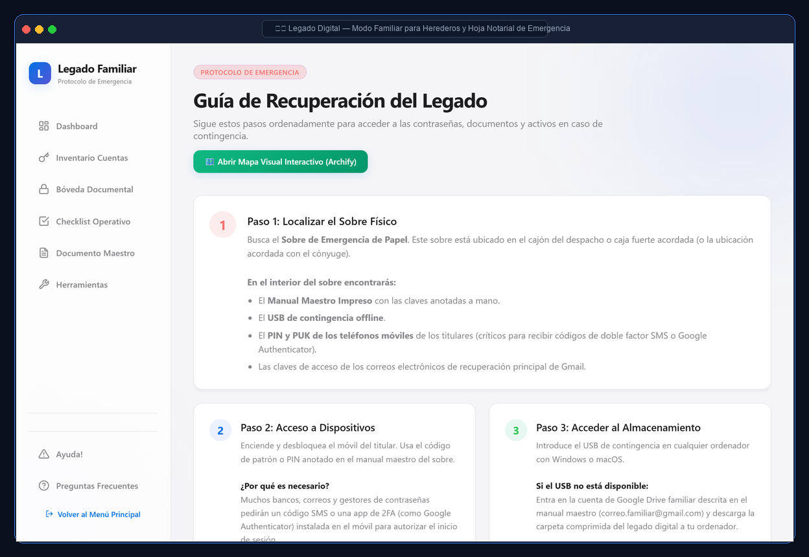
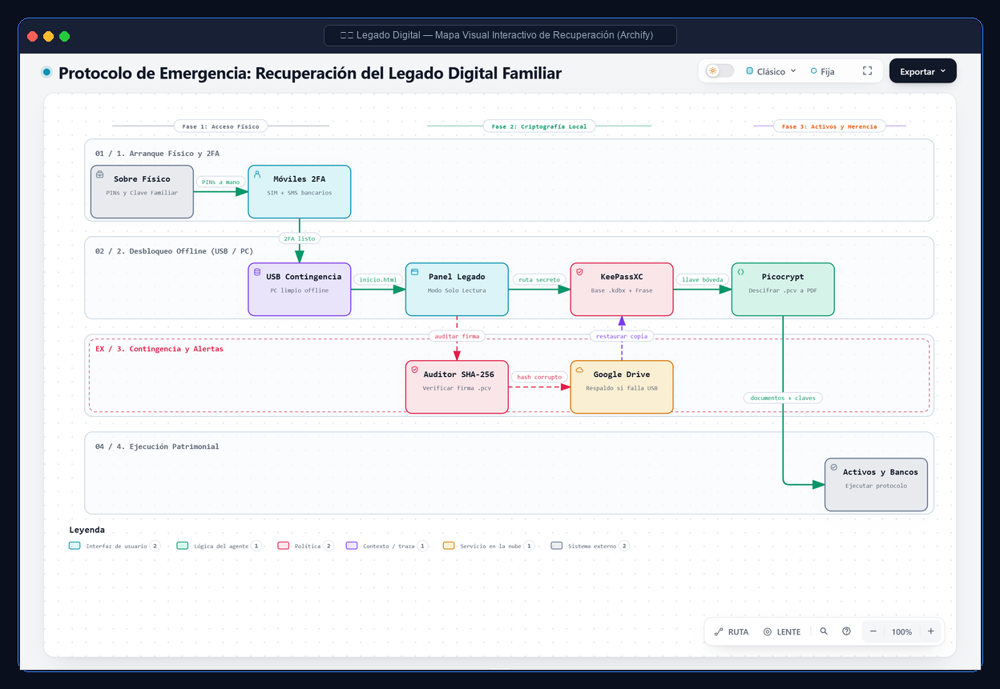

<div align="center">

# 🛡️ Legado Digital Familiar · Digital Legacy Vault
### *Offline-First · Air-Gapped · Pure HTML5 & Web Crypto Architecture*

[](CHANGELOG.md)
[](LICENSE)
[](MATRIZ_CUMPLIMIENTO_ISO_SOC2.md)
[-red.svg?style=flat-square)](#threat-model--security-architecture)
[](#key-features)

**[English Documentation](#-english-documentation) · [Documentación en Español](#-documentación-en-español)**

<p align="center" style="margin-top: 16px;">
  <a href="https://andresgonzalezperez-hash.github.io/legado-digital-familiar/">
    
  </a>
</p>

---

<p align="center">
  
</p>

</div>

<a id="english-documentation"></a>
# 🇬🇧 English Documentation

## 1. Executive Summary & Purpose

> [!TIP]
> **🚀 Try the Live Interactive Demo (Zero Installation & Zero Tracking):**  
> Test the vault directly in your browser: **[andresgonzalezperez-hash.github.io/legado-digital-familiar](https://andresgonzalezperez-hash.github.io/legado-digital-familiar/)**  
> Open DevTools (`F12` -> Network) and inspect for yourself: zero outbound requests, zero telemetries, 100% client-side Web Crypto execution.

**Legado Digital Familiar** is an open-source, air-gapped sovereign infrastructure designed to organize, safeguard, and delegate your digital estate, asset inventory, and family emergency protocols. 

Built entirely in **100% Pure W3C HTML5/CSS/JavaScript with the Web Crypto API**, it guarantees perpetual access across decades without relying on external servers, third-party cloud backends, subscriptions, or fragile mobile application stores (no APK/AppStore obsolescence).

> [!WARNING]
> **CRITICAL SECURITY ADVISORY:**
> This repository is pre-configured with strict `.gitignore` rules. **NEVER commit or upload master passwords, cryptocurrency seed phrases, password databases (`.kdbx`), encrypted vault files (`.pcv`), or unencrypted personal PDFs to GitHub**. This software must run exclusively in a local, offline environment or on encrypted offline USB drives.

---

## 📸 Interface & Workflow Gallery

<div align="center">

### 1. Air-Gapped Sovereign Unlock & Keylogger Guard
*Client-side local AES-256-GCM decryption with host security advisory notice.*


### 2. Main Dashboard & Real-Time Data Freshness Tracker
*Status of the 3 security layers (Passbolt, Picocrypt, Physical Kit) and obsolescence semaphore.*


### 3. Asset Directory & SHA-256 Bit-Rot Integrity Auditor
*Banking, insurance policies, and cloud credentials catalog with live hash verification.*


### 4. Heir Contingency Protocol & Printable Notary Worksheet
*Cognitive-grief adapted steps for non-technical family members and sealed envelope worksheet.*


### 5. Interactive Visual Recovery Swimlanes (`Archify`)
*Standalone, zero-dependency animated contingency map.*


</div>

---

## 🏷️ Official Version History & Release Milestones

| Version | Release Date | Key Milestone & Technical Highlights |
| :--- | :--- | :--- |
| **`v1.4.1`** | **05/11/2026** | **Red Team Hardening & Freshness Audit**: Real-time information freshness semaphore (🟢 <90d, 🟡 90-180d, 🔴 >180d), physical Notary Emergency Access Sheet generator, host keylogger security warnings, and Art. 96 LOPD-GDD legal inheritance disclaimer. [View Details](CHANGELOG.md#141---2026-11-05). |
| **`v1.4.0`** | **05/11/2026** | **Regulatory Hardening & Pure HTML**: Audited compliance with ISO/IEC 27001, ISO/IEC 27701, and SOC 2 Type II. Hermetic CSP (`connect-src 'none'`), active RAM zeroization (`crypto.getRandomValues`), object immutability (`Object.freeze`), and permanent retirement of the Android APK. [View Details](CHANGELOG.md#140---2026-11-05). |
| **`v1.3.0`** | **03/11/2026** | **Archify Recovery Map & UI Modernization**: Standalone animated recovery map (`APP/mapa-recuperacion.html`), native `<dialog>` modals, Toast notifications, and View Transitions API. [View Details](CHANGELOG.md#130---2026-11-03). |
| **`v1.2.0`** | **16/10/2026** | **Cryptographic RAM Shielding**: Non-extractable session keys (`extractable: false`), encrypted AES-256-GCM backups, and real-time SHA-256 bit-rot integrity checker. [View Details](CHANGELOG.md#120---2026-10-16). |
| **`v1.1.0`** | **07/10/2026** | **Offline PWA & Archival Engine**: Native offline PWA installation via Service Worker, web manifest, and notarial A4 PDF export engine. [View Details](CHANGELOG.md#110---2026-10-07). |
| **`v1.0.0`** | **24/05/2026** | **Initial Release**: Offline-first vault with client-side encryption, asset catalog, and step-by-step family contingency checklist. |

---

## 🚀 Key Features

* **100% Pure Web W3C (Store & APK-Free)**: Runs instantly in any standard web browser across Windows, macOS, Linux, iOS, and Android simply by opening `inicio.html`. Immune to mobile operating system deprecation and application store bans.
* **ISO 27001, ISO 27701 & SOC 2 Type II Hardening**:
  * **Hermetic CSP**: Strict `<meta>` Content Security Policy forbidding any outbound network requests (`connect-src 'none'`).
  * **Active RAM Zeroization**: Overwrites sensitive session memory with cryptographically secure random bytes upon logout or timeout.
  * **Runtime Immutability**: Core cryptographic engines and helpers are frozen via `Object.freeze()`.
  * **Anti-XSS DOM Sanitization**: Comprehensive input escaping across all view layers.
* **Data Freshness Tracker & Obsolescence Semaphore**: Calculates days since the last vault review and warns when assets, insurance policies, or credentials may be outdated (🟢 Fresh, 🟡 Review Recommended, 🔴 Stale).
* **Interactive Emergency Visual Map (`Archify`)**: Embedded interactive visual guide ([`APP/mapa-recuperacion.html`](APP/mapa-recuperacion.html)) with 4 guided recovery swimlanes for non-technical family members.
* **Dual Operational Modes**:
  * **Master Owner Mode**: Full administrative privileges, estate editing, and security checklist validation.
  * **Family Emergency Mode (Read-Only)**: Clear, grief-adapted step-by-step guidance without any risk of accidental data deletion.
* **Notarial Export & Emergency Worksheets**:
  * One-click generation of the **Master PDF Document** formatted for legal archiving.
  * Printable **Emergency Notary Access Sheet** for physical sealed notary envelopes.
* **SHA-256 Bit-Rot Integrity Auditing**: Built-in verification against silent storage media degradation.

---

## 📁 Repository Structure

```text
legado-digital-familiar/
├── APP/                             # Core web application engine
│   ├── core/                        # Crypto, state, router & security primitives
│   ├── modules/                     # Dashboard, inventory, PDF, checklists
│   ├── sw.js                        # Offline Service Worker cache
│   ├── mapa-recuperacion.html       # Standalone Archify interactive recovery map
│   └── index.html                   # Main application entry point
├── START/                           # Automated emergency scripts (e.g. Drive mirror)
├── TOOLS/                           # Recommended offline utilities (Picocrypt)
├── docs/screenshots/                # High-resolution bilingual UI mockups (EN / ES)
├── inicio.html                      # Root launcher (open directly in any browser)
├── MATRIZ_CUMPLIMIENTO_ISO_SOC2.md  # Formal regulatory compliance audit matrix
├── DOCUMENTACION_MAESTRA.md         # Exhaustive technical and operational manual
└── CHANGELOG.md                     # Full chronological version changelog
```

---

## ⚙️ Quick Start

1. Clone or download this repository onto a clean computer or offline USB drive.
2. Double-click **`inicio.html`** in the root directory.
3. Your browser will execute the vault locally without sending a single byte over the network.

---

## ⚖️ Legal & Inheritance Disclaimer
*In accordance with Spanish Civil Code and Article 96 of Organic Law 3/2018 (LOPD-GDD):*  
This system and its generated reports serve solely as an informative, private inventory to assist heirs and executors in identifying and locating assets. **It does not constitute a formal legal will, nor does it provide legal authority to transfer funds or close accounts prior to the official settlement of inheritance deeds and tax obligations.**

---
---

<a id="documentación-en-español"></a>
# 🇪🇸 Documentación en Español

<p align="center">
  
</p>

## 1. Resumen Ejecutivo y Propósito

> [!TIP]
> **🚀 Prueba la Demo Interactiva en Vivo (Sin instalación ni servidores):**  
> Abre la bóveda directamente en tu navegador: **[andresgonzalezperez-hash.github.io/legado-digital-familiar](https://andresgonzalezperez-hash.github.io/legado-digital-familiar/)**  
> Abre la consola de desarrollo (`F12` -> Red) y compruébalo tú mismo: cero conexiones salientes, cero cookies, ejecución local 100% segura en tu navegador.

**Legado Digital Familiar** es una infraestructura soberana de código abierto diseñada para organizar, proteger y delegar tu patrimonio digital, inventario de activos y protocolos de emergencia familiares.

Construida íntegramente en **HTML5/CSS/JavaScript puro W3C con la Web Crypto API**, garantiza el funcionamiento perpetuo a lo largo de décadas sin depender de servidores externos, servicios en la nube de terceros, suscripciones ni tiendas de aplicaciones móviles (sin riesgo de obsolescencia de APKs o App Store).

> [!WARNING]
> **ADVERTENCIA DE SEGURIDAD CRÍTICA:**
> Este repositorio cuenta con un archivo `.gitignore` estricto. **NUNCA subas contraseñas maestras, frases semilla de criptomonedas, bases de datos (`.kdbx`), archivos cifrados (`.pcv`) ni PDFs personales desprotegidos a GitHub**. Este software debe utilizarse exclusivamente en entornos locales, desconectados de internet (Air-Gapped) o en unidades USB privadas.

---

## 📸 Galería Visual de Pantallas y Flujos

<div align="center">

### 1. Desbloqueo Seguro y Clave Maestra (Air-Gapped)
*Descifrado AES-256-GCM local en navegador con advertencia preventiva contra keyloggers.*


### 2. Panel Principal y Semáforo de Frescura en Tiempo Real
*Supervisión de las 3 capas (Passbolt, Picocrypt, Soporte Físico) y alerta de obsolescencia.*


### 3. Directorio de Activos y Verificador Criptográfico SHA-256
*Inventario patrimonial con comprobación de integridad contra degradación magnética (bit-rot).*


### 4. Modo Familiar y Hoja Notarial de Emergencia
*Protocolo de contingencia paso a paso para herederos y plantilla para sobre cerrado.*


### 5. Mapa Visual Interactivo de Contingencia (`Archify`)
*Diagrama interactivo autónomo con las 4 carrileras de actuación en emergencia.*


</div>

---

## 🏷️ Historial de Versiones Oficiales

| Versión | Fecha | Hito Principal y Aspectos Técnicos |
| :--- | :--- | :--- |
| **`v1.4.1`** | **05/11/2026** | **Blindaje Red Team & Auditoría de Frescura**: Semáforo interactivo de frescura de información (🟢 <90d, 🟡 90-180d, 🔴 >180d), plantilla imprimible de Hoja Notarial de Emergencia, avisos de seguridad contra keyloggers y cláusula sucesoria bajo Art. 96 LOPD-GDD. [Ver Detalles](CHANGELOG.md#141---2026-11-05). |
| **`v1.4.0`** | **05/11/2026** | **Hardening Normativo & Pure HTML**: Cumplimiento auditado con ISO/IEC 27001, ISO/IEC 27701 y SOC 2 Type II. CSP hermética (`connect-src 'none'`), zeroización en RAM (`crypto.getRandomValues`), inmutabilidad con `Object.freeze` y retirada definitiva de la APK. [Ver Detalles](CHANGELOG.md#140---2026-11-05). |
| **`v1.3.0`** | **03/11/2026** | **Mapa Archify & Modernización UI**: Mapa interactivo de contingencia (`APP/mapa-recuperacion.html`), modales nativos `<dialog>`, notificaciones Toast y View Transitions API. [Ver Detalles](CHANGELOG.md#130---2026-11-03). |
| **`v1.2.0`** | **16/10/2026** | **Blindaje Criptográfico en RAM**: Claves de sesión no extraíbles (`extractable: false`), copias cifradas con AES-256-GCM y verificador de integridad SHA-256 en tiempo real. [Ver Detalles](CHANGELOG.md#120---2026-10-16). |
| **`v1.1.0`** | **07/10/2026** | **PWA Offline & Motor Notarial**: Soporte de instalación offline con Service Worker, manifiesto web y motor de exportación a PDF A4. [Ver Detalles](CHANGELOG.md#110---2026-10-07). |
| **`v1.0.0`** | **24/05/2026** | **Lanzamiento Inicial**: Bóveda desconectada con cifrado local, inventario patrimonial y checklist guiado de contingencia familiar. |

---

## 🚀 Características Principales

* **100% Pure Web W3C (Sin APKs ni Tiendas)**: Ejecución inmediata en cualquier navegador moderno (Windows, macOS, Linux, iOS y Android) abriendo directamente `inicio.html`. Inmune al abandono de versiones de sistemas operativos móviles.
* **Hardening Normativo ISO 27001, ISO 27701 y SOC 2**:
  * **CSP Hermética**: Directiva de seguridad en cabecera `<meta>` que bloquea toda salida hacia internet (`connect-src 'none'`).
  * **Zeroización Activa en RAM**: Sobrescritura de memoria con bytes criptográficos aleatorios al cerrar sesión o por inactividad.
  * **Inmutabilidad en Runtime**: Motores criptográficos sellados mediante `Object.freeze()`.
  * **Sanitización Integral Anti-XSS**: Escapado automático de datos en todas las capas del DOM.
* **Semáforo de Frescura de Información**: Detección de desfase temporal desde la última actualización para alertar sobre pólizas o cuentas bancarias desactualizadas (🟢 Al día, 🟡 Revisión recomendada, 🔴 Desactualizado).
* **Mapa Visual Interactivo de Contingencia (`Archify`)**: Diagrama interactivo ([`APP/mapa-recuperacion.html`](APP/mapa-recuperacion.html)) con 4 carrileras ordenadas paso a paso para familiares sin conocimientos técnicos.
* **Doble Modo Operativo**:
  * **Modo Titular**: Administración total, edición de activos y verificación de checklists de seguridad.
  * **Modo Familiar (Solo Lectura)**: Asistente guiado para contingencias sin peligro de borrado accidental.
* **Exportación Notarial y Hojas de Contingencia**:
  * Generación del **Documento Maestro PDF** preparado para archivo documental formal.
  * Impresión de la **Hoja de Acceso Notarial de Emergencia** para sobre cerrado o caja de seguridad física.
* **Auditoría de Integridad SHA-256**: Comprobación contra la degradación magnética de datos (*bit-rot*).

---

## 📁 Estructura del Repositorio

```text
legado-digital-familiar/
├── APP/                             # Núcleo de la aplicación web
│   ├── core/                        # Criptografía, estado, router y helpers
│   ├── modules/                     # Dashboard, inventario, PDF, checklists
│   ├── sw.js                        # Service Worker de caché offline
│   ├── mapa-recuperacion.html       # Mapa visual interactivo Archify
│   └── index.html                   # Vista principal de la aplicación
├── START/                           # Scripts automatizados de respaldo
├── TOOLS/                           # Utilidades offline recomendadas (Picocrypt)
├── docs/screenshots/                # Mockups visuales bilingües en alta resolución
├── inicio.html                      # Acceso directo raíz para el navegador
├── MATRIZ_CUMPLIMIENTO_ISO_SOC2.md  # Matriz de cumplimiento normativo
├── DOCUMENTACION_MAESTRA.md         # Manual técnico integral
└── CHANGELOG.md                     # Registro histórico de versiones
```

---

## ⚙️ Puesta en Marcha Rápida

1. Descarga o clona este repositorio en un ordenador seguro o memoria USB de contingencia.
2. Haz doble clic en **`inicio.html`** en la raíz del proyecto.
3. La aplicación se ejecutará de forma instantánea en tu navegador sin requerir conexión a internet.

---

## ⚖️ Aviso Legal y Sucesorio
*Conforme al Código Civil y al Art. 96 de la Ley Orgánica 3/2018 (LOPD-GDD):*  
Este sistema y sus reportes impresos constituyen exclusivamente un inventario informativo privado de ayuda y coordinación familiar. **No constituyen un testamento formal ni confieren facultades para disponer de cuentas bancarias o transferir activos con anterioridad a la formal adjudicación de herencia y liquidación tributaria ante los organismos competentes.**
